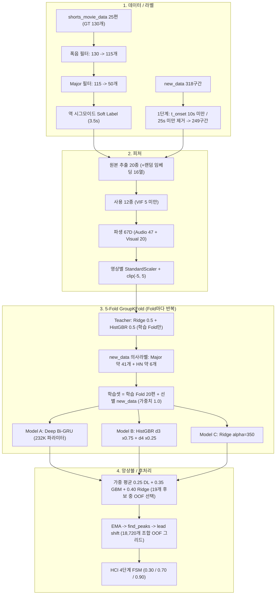
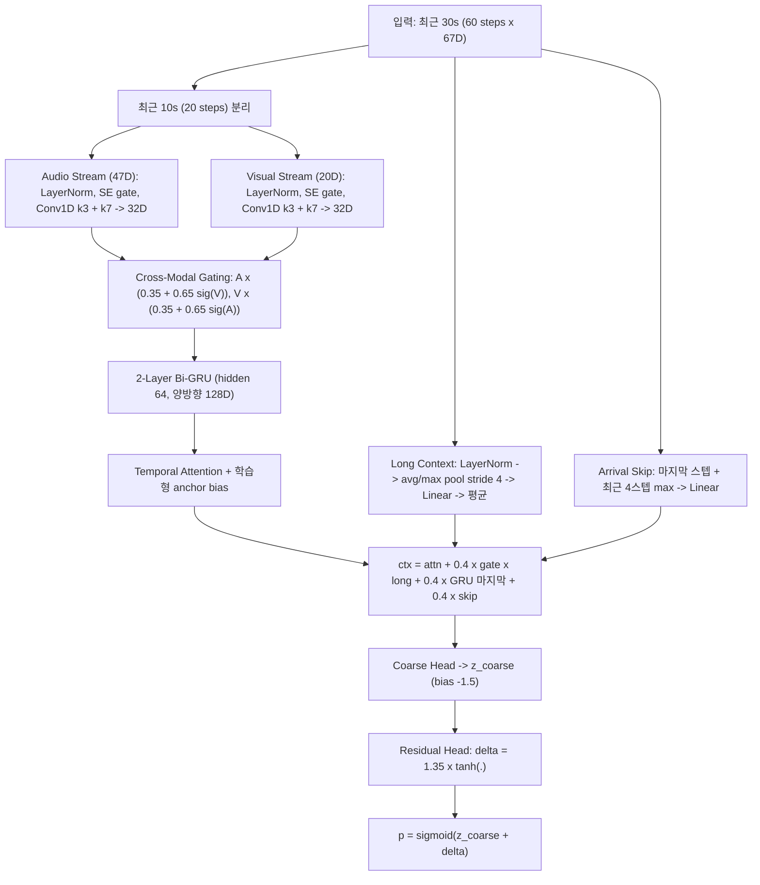

# SnapGuard 현재 모델 아키텍처 · 피처 · 하이퍼파라미터 리포트

> **기준 시점**: 2026-11-06 6차 파이프라인 (`run_gpu_pipeline.py`, Major-Only 타깃 + 정제 `new_data` 1:1 결합)
> **목적**: 모델링 단순화 판단용 현황 정리. 코드에서 실제로 동작하는 값만 기록했습니다.
> **최종 OOF 결과**: Event F1 `0.5049` · Recall `52.0% (26/50)` · Precision `49.1%` · FA `27회` (HN `4회`) · 평균 선행시간 **`0.04초`**

---

## 1. 전체 파이프라인 한눈에 보기

| 단계 | 파일 | 핵심 함수 |
| :--- | :--- | :--- |
| 라벨 / 필터 / 의사라벨 | [data_labeling.py](file:///e:/Data_analyze_jump_scare/snapguard/data_labeling.py) | `parse_ground_truth`, `create_sigmoid_soft_labels`, `filter_shock_only_gt`, `select_fold_pseudo_labeled_new_data` |
| 피처 추출 / 파생 | [feature_engineering.py](file:///e:/Data_analyze_jump_scare/snapguard/feature_engineering.py) | `FullDomainMultimodalExtractor`, `engineer_multiscale_features` |
| 딥러닝 모델 / 손실 | [model.py](file:///e:/Data_analyze_jump_scare/snapguard/model.py) | `Seq20JumpscareDataset`, `MultiScaleCrossModalSnapGuard`, `SnapGuardHNMLoss` |
| 학습 / 앙상블 | [train_eval.py](file:///e:/Data_analyze_jump_scare/snapguard/train_eval.py) | `run_5fold_group_cv` |
| 후처리 / FSM | [postprocess_hci.py](file:///e:/Data_analyze_jump_scare/snapguard/postprocess_hci.py) | `detect_scare_peaks`, `optimize_postprocessing_oof`, `SnapGuardHCIFSM` |
| 설정 | [config.py](file:///e:/Data_analyze_jump_scare/snapguard/config.py) | - |

---

## 2. 데이터 · 라벨 단계

### 2.1 타깃 필터 (`filter_shock_only_gt`)
GT 이벤트 주변 `[t-1.5s, t+1.5s]`의 **영상별 Robust Z(중앙값/MAD)**로 판정합니다.

| 파라미터 | 값 | 의미 |
| :--- | :---: | :--- |
| `SHOCK_MIN_RMS_Z` | 0.85 | 최대 RMS Z가 이 값 이상이어야 함 (필수) |
| `SHOCK_MIN_DIFF_Z` | 1.50 | RMS 상승 기울기 Z (아래 3개 중 하나 이상 충족) |
| `SHOCK_MIN_JUMP_Z` | 1.00 | 직전 `[t-4.0s, t-0.5s]` 최저 RMS 대비 점프량 |
| `SHOCK_MIN_BP_Z` | 3.00 | 60~250Hz `bass_punch` Z |
| `MAJOR_ONLY_GT` | True | Minor 65개를 타깃에서 제외 → **배경(0.0)으로 학습됨** |

결과: 130개 → 폭음 115개 → **Major 50개**.

### 2.2 Soft Label (`create_sigmoid_soft_labels`)

$$y(\Delta t) = \text{peak} \cdot \frac{1}{1 + e^{(\Delta t - t_0)/k}}, \quad \Delta t = t_{\text{scare}} - t \in [0, H]$$

| 파라미터 | 값 | 비고 |
| :--- | :---: | :--- |
| `SIGMOID_HORIZON_SEC` (H) | 3.5s | 라벨이 켜지는 사전 구간 |
| `SIGMOID_T0` | 1.2s | 변곡점 |
| `SIGMOID_K` | 0.55 | 기울기 |
| `PEAK_MAJOR` | 1.0 | `PEAK_MINOR=0.70`은 Major-Only라 **현재 미사용** |
| 타격 직후 `t+0.5s` | 0.78 × peak | 코드 하드코딩 |
| Double-Tap 리셋 | 이전 이벤트와 3.5s 이내면 H를 축소 | 코드 하드코딩 (`VALLEY_RESET_DOUBLE_TAP` 설정값은 실제로 참조 안 됨) |
| HN 보호 구간 | `[t-2.5s, t+0.5s]` | 하드코딩 (`INHALE_PROTECT_SEC` 설정값 미참조) |

### 2.3 `new_data` 3단계 정제

| 단계 | 규칙 | 결과 |
| :--- | :--- | :--- |
| 1단계 | `t_onset ≥ 10s` and `길이 ≥ 25s` | 318 → 249구간 |
| 2단계 | 동일 추출기로 2 FPS 피처 캐싱 | 19,468 steps |
| 3단계 양성 | Teacher `pk_p ≥ 0.44`, 돌출도 `≥ 0.28`, 배경최대 `≤ 0.34`, (`vis_aud_shock_sync ≥ 1.5` or `dual_band_hz_shock ≥ 2.0`), `aud_inhale_shock ≥ 1.5` | Fold당 약 41개 (`jumpscare_major`) |
| 3단계 HN | `pk_p ≤ 0.16`, 배경최대 `≤ 0.28`, `vis_aud_shock_sync ≤ 0.15` → `[t-2.0s, t+1.5s]`를 HN 마스킹 | Fold당 약 6개 |
| 제외 | 나머지 | 약 200구간 (전체의 ~80%) |

---

## 3. 피처

### 3.1 원본 추출 (20종 + 랜덤 임베딩) → 사용 12종

| 모달리티 | 추출 피처 | 사용 여부 |
| :--- | :--- | :--- |
| Audio (14) | `rms`, `hf_scream`(2.5~6kHz), `bass_punch`(60~250Hz), `lfe`(45~90Hz), `spectral_flux`, `hf_ratio`(2~7kHz 비율), `centroid_slope`, `heartbeat_accel` | **사용 (8)** |
| | `rms_drop`, `hnr`, `sub_bass`, `spectral_rolloff`, `spectral_bandwidth`, `spectral_crest` | 추출만 하고 미사용 (6) |
| Visual (6) | `flow_mag`, `darkness`(L<20), `saliency_entropy`, `tau_cut` | **사용 (4)** |
| | `flow_entropy`, `lum_std` | 추출만 하고 미사용 (2) |
| 랜덤 임베딩 | `aud_emb_0~7`, `vis_emb_0~7` (학습 안 된 랜덤 MLP 투영) | 매번 계산·캐싱하지만 미사용 (`INCLUDE_RANDOM_DEEP_EMB=False`) |

추출 스펙: 16kHz, 0.5s 스텝, STFT `n_fft=2048`, `hop=500` (스텝당 16 서브프레임), 비디오 160×90 그레이스케일.

### 3.2 파생 67D (`engineer_multiscale_features`)

| 그룹 | 대상 | 변환 | 차원 |
| :--- | :--- | :--- | :---: |
| 오디오 포락선 | `rms`, `hf_scream`, `bass_punch`, `lfe`, `spectral_flux`, `hf_ratio` | 원본, `diff_w10`(s−ma10), `trend_w10_30`(ma10−ma30), `surge_w4`(s−과거 min4), `valley_w10`(ma10−과거 min10), `max_w4`(최근 3스텝 max−s) | 6×6 = **36** |
| 오디오 미분 | `centroid_slope`, `heartbeat_accel` | 원본, `ma_w6`, `peak_w3` | 2×3 = **6** |
| 오디오 교차항 | - | `aud_inhale_shock`, `aud_hf_inhale_shock`, `dual_band_hz_shock`, `hf_flux_shock`, `aud_lfe_rms_inter` | **5** |
| 비디오 포락선 | `flow_mag`, `darkness`, `saliency_entropy` | 원본, `diff_w10`, `trend_w10_30`, `surge_w4`, `max_w4` | 3×5 = **15** |
| 비디오 컷 | `tau_cut` | 원본, `vis_cut_after_hold` | **2** |
| 비디오 교차항 | - | `freeze_dark_cut`, `vis_dark_focus_inter`, `vis_aud_shock_sync` | **3** |
| **합계** | | | **67** (Audio 47 + Visual 20) |

- 정규화: **영상(클립) 단위 StandardScaler** → `clip(-5, 5)`. 영상 전체 통계를 사용합니다.
- 구조적으로 **6개 신호 × 6개 시간 스케일 = 36D가 전체의 54%**를 차지합니다.

---

## 4. 모델

### 4.1 Model A — `MultiScaleCrossModalSnapGuard` (Deep Bi-GRU)

**파라미터 수: 231,833개**

| 모듈 | 파라미터 | 비중 |
| :--- | ---: | ---: |
| `gru` (2층 Bi-GRU) | 124,416 | 53.7% |
| `long_ctx_gate` | 32,896 | 14.2% |
| `long_proj` | 17,536 | 7.6% |
| `arrival_skip` | 17,536 | 7.6% |
| `audio_stream` | 11,062 | 4.8% |
| `attn` | 8,321 | 3.6% |
| `residual_head` / `coarse_logit_head` | 6,289 / 6,241 | 5.4% |
| `visual_stream` | 4,886 | 2.1% |
| 기타 (gating, norm) | 2,630 | 1.1% |

> 학습 Fold당 양성(Major) 이벤트는 shorts 약 40개 + new_data 약 41개 ≈ **81개**입니다. 이벤트 1개당 약 2,900개 파라미터입니다.

**손실 함수 (`SnapGuardHNMLoss`)**

| 항 | 수식 / 값 |
| :--- | :--- |
| 가중 Focal MSE | 가중치: y≥0.08 → 4.2, y≥0.35 → 7.0 (`W_MINOR`), y≥0.60 → 12.0 (`W_MAJOR`); focal `(1+|e|)^1.25` |
| 배경 페널티 | `2.5 × ReLU(p − 0.12)²` (y<0.05, HN 아님) |
| HN 페널티 | `5.0 × ReLU(p − 0.10)²` |
| 대조 마진 | `2.0 × ReLU(0.45 − (mean_peak − mean_neg))²` |
| 보조 헤드 | `0.7 × final + 0.3 × coarse` |

**학습 / 샘플링**

| 파라미터 | 값 |
| :--- | :--- |
| `STREAM_DIM` / `HIDDEN_DIM` / `DROPOUT` | 32 / 64 / 0.30 (+ 채널 Dropout1d 0.15) |
| `RESIDUAL_ALPHA` | 1.35 |
| 배경 유지 `BG_KEEP_RATIO` | 0.40 |
| HN 오버샘플 / 피크 오버샘플 | 2배 / 4배 (y≥0.45), 2배 (0.20≤y<0.45) |
| Optimizer | AdamW `lr=1e-3`, `weight_decay=2e-3`, grad clip 1.0 |
| Scheduler | CosineAnnealing `T_max=25`, `eta_min=1e-5` |
| Epoch / Batch | 25 / 64 |
| 체크포인트 선택 | **검증 Fold**의 `F1 + 0.15 × 분리도`가 최고인 epoch (임계 4개 × prominence 3개 탐색) |

### 4.2 Model B — HistGradientBoosting (2개 블렌딩)

| 파라미터 | d3 모델 | d4 모델 |
| :--- | :---: | :---: |
| `max_iter` | 130 | 120 |
| `max_depth` | 3 | 4 |
| `min_samples_leaf` | 55 | 45 |
| `l2_regularization` | 20.0 | 15.0 |
| `learning_rate` | 0.045 | 0.05 |
| 블렌딩 | × 0.75 | × 0.25 |
| 샘플 가중치 | 배경 1 / y≥0.05 → 8 / y≥0.55 → 16 / HN → 4 | 동일 |

입력: **현재 시점 67D 한 행** (시퀀스 아님. 시간 문맥은 파생 피처에만 들어 있음).

### 4.3 Model C — Ridge

| 파라미터 | 값 |
| :--- | :--- |
| `alpha` | 350.0 |
| 샘플 가중치 | 배경 1 / y≥0.05 → 6 / y≥0.55 → 12 / HN → 6 |

### 4.4 앙상블

- 19개 고정 가중치 후보 `(w_dl, w_gbm, w_ridge)` 중 **OOF F1 최고값** 선택 → 현재 `(0.25, 0.35, 0.40)`.
- 확률 직접 가중 평균 후 `clip(0, 1)`.

---

## 5. 후처리 · HCI FSM

| 파라미터 | 탐색 범위 | 현재 선택값 |
| :--- | :--- | :---: |
| `ema_alpha` | {0.40, 0.55, 0.70, 0.85, 1.0} | 0.40 |
| `cooldown_steps` | {6, 8, 10, 12, 14, 16} | 14 (7s) |
| `abs_th` | 0.14~0.55, 16단계 | 0.304 |
| `prom_th` | 0.05~0.35, 13단계 | 0.275 |
| `lead_shift_steps` | {0, 1, 2} | 2 (트리거를 1s 앞당김) |
| **총 조합 수** | 5 × 6 × 16 × 13 × 3 = **18,720** | OOF에서 직접 선택 |

평가 규칙: GT 기준 `[t−3.5s, t+1.0s]` 안에 트리거가 있으면 Hit, `[t−4.0s, t+1.5s]` 밖의 트리거는 오탐.

**HCI FSM**: `0.30 / 0.70 / 0.90` 임계. 현재 앙상블 확률 최대치가 0.5~0.7 수준이라 **INHALE·ARRIVAL 상태가 한 번도 발생하지 않습니다** (샘플 영화: INHALE 0, ARRIVAL 0 스텝).

---

## 6. 구성요소별 기여도 vs 비용

| 구성요소 | 단독 OOF F1 | 비용 / 복잡도 | 판단 근거 |
| :--- | :---: | :--- | :--- |
| HistGBR (d3+d4) | **0.4898** | 수 초, 하이퍼 10개 | 단독으로 앙상블과 거의 동일 |
| Ridge | 0.3960 | 1초 미만, 하이퍼 1개 | 단독 성능 낮음 |
| Deep Bi-GRU | 0.3200 | 23만 파라미터, 전체 실행 ~17분 중 대부분, 하이퍼 30개 이상 | 단독 성능 최하위 |
| 3모델 앙상블 | 0.5049 | 위 전부 + 가중치 탐색 | HistGBR 단독 대비 **+0.015** |

> 검증 이벤트가 50개뿐이라 이벤트 1개 = Recall 2%p입니다. HistGBR 단독(24/50)과 앙상블(26/50)의 차이는 **이벤트 2개**이고, 이 정도 차이는 아래 6절 2번의 OOF 튜닝 편향 범위 안에 있습니다.

### 하이퍼파라미터 개수 (대략)

| 영역 | 개수 |
| :--- | :---: |
| 타깃 필터 + Soft Label | ~12 |
| new_data 정제 / 의사라벨 | ~12 |
| 피처 윈도우 / 임계 | ~10 |
| Deep Bi-GRU (구조 + 손실 + 샘플링 + 최적화) | ~35 |
| HistGBR × 2 + Ridge + 샘플 가중치 | ~17 |
| 앙상블 + 후처리 + FSM | ~10 |
| **합계** | **약 100개** |

학습 Fold당 양성 이벤트가 약 81개인 데이터에 비해 조절 손잡이가 많습니다.

---

## 7. 평가 신뢰성 관련 발견 사항 (판단 전에 꼭 보셔야 할 부분)

1. **선행 경고 시간이 사실상 0초입니다.** 실측 평균 lead time은 **`+0.04s`**이고, 이마저도 트리거를 인위적으로 1초 당긴(`lead_shift_steps=2`) 결과입니다. 시프트를 빼면 모델 피크는 평균적으로 **타격 후 약 1초**에 나옵니다. 즉 현재 모델은 "예측"보다 "폭음 직후 감지"에 가깝습니다. (이전 보고에서 쓴 `+0.73s`는 잘못된 수치였습니다. 아래 정정 참고.)
2. **OOF 점수가 낙관적으로 편향되어 있습니다.**
   - 후처리 18,720개 조합과 앙상블 19개 후보를 **같은 OOF에서** 골랐습니다.
   - Deep Bi-GRU는 **검증 Fold 성능으로 epoch를 선택**하므로 검증 정보가 학습에 새어 들어갑니다.
   - 따라서 `0.5049`는 상한에 가까운 값이고, `0.5055` vs `0.5049` 같은 차이는 의미가 없습니다.
3. **실시간 배포가 어려운 정규화입니다.** 영상 단위 StandardScaler가 **영상 전체(미래 포함) 통계**를 씁니다. 또 `new_data`는 폭음 하나를 중심으로 자른 40초 클립 단위로 정규화되어, 수 분짜리 영화와 스케일 분포가 다릅니다.
4. **평가가 순환 구조에 가깝습니다.** 타깃 필터(RMS·bass 기준)와 의사라벨 규칙(오디오 충격 피처 + GBM/Ridge Teacher)이 모델 입력과 같은 오디오 신호를 씁니다. 그래서 `new_data` 양성은 원래 모델이 잘 맞히는 "쉬운 폭음" 위주로 뽑혔을 가능성이 높습니다. 실제로 `new_data` 추가 후 Precision은 올랐지만(33.7%→49.1%) Recall은 내려갔습니다(62.0%→52.0%).
5. **Minor 65개가 배경(0.0)으로 학습됩니다.** 폭음이 분명한 Minor 장면이 "점프스케어 아님"으로 학습되어, Major와 Minor를 가르는 근거가 음량 크기 차이(~1.8배)에 크게 의존하게 됩니다.
6. **죽은 코드 / 설정**: 미사용 원본 피처 8종 + 랜덤 임베딩 16열 추출, HCI FSM 상위 2단계 미작동, `PEAK_MINOR`·`VALLEY_RESET_DOUBLE_TAP`·`INHALE_PROTECT_SEC`·`PROMINENCE_MIN/MAX`·`PROCESSED_FEATURE_CACHE_PATH` 설정값 미참조.

---

## 8. 단순화 후보 (결정은 사용자 판단)

| ID | 후보 | 예상 효과 | 위험 | 제 의견 |
| :---: | :--- | :--- | :--- | :--- |
| S1 | **Deep Bi-GRU 제거** → HistGBR (± Ridge) | 실행 ~17분 → 1~2분, 하이퍼 ~35개 감소 | OOF F1 −0.015 내외 (이벤트 1~2개) | 강력 추천 |
| S2 | HistGBR 2개 블렌딩 → 1개 | 하이퍼 5개 감소 | 거의 없음 | 추천 |
| S3 | Ridge 제거 여부 | 하이퍼 소폭 감소 | 블렌딩 이득 소실 가능 | S1 후 재측정해서 결정 |
| S4 | 67D 축소 (6스케일 → 2~3스케일, 교차항 정리) | 피처 수 절반 이하 | 미검증 | GBM 기반 ablation으로 결정 |
| S5 | 후처리 단순화: `ema` 고정, `lead_shift=0`, `cooldown` 고정, `abs_th`/`prom_th`만 튜닝 | 조합 18,720 → ~200, 편향 감소 | 점수 수치는 내려갈 수 있음 | 추천 (점수가 더 정직해짐) |
| S6 | Nested CV로 후처리·앙상블 튜닝 | 낙관 편향 제거 | 연산 증가(작음) | S1 이후라면 부담 적음 |
| S7 | 인과적 정규화 (과거 구간만 쓰는 running mean/std) | 실시간 배포 가능, new_data 스케일 불일치 해소 | 피처 재계산 필요 | 배포 목표라면 필수 |
| S8 | HCI FSM 분리 또는 임계 재보정 | 평가 파이프라인 단순화 | 없음 | 추천 |
| S9 | 미사용 피처·랜덤 임베딩 추출 제거, 미참조 설정 삭제 | 코드 정리 | 기존 캐시 CSV 호환 | 추천 |
| S10 | Minor 처리 방식 결정 (배경 0.0 / 학습 제외 / 보조 라벨) | 라벨 일관성 | 이전 실험상 F1 차이 작음 | 방향만 정해주시면 됨 |

---

## 9. 이전 보고 수치 정정

- 6차 결과의 **평균 선행 경고 시간 `+0.73s`는 잘못된 값입니다.** `oof_eval_summary.json` 실측값은 **`+0.038s`**입니다. 개별 모델은 DL `+0.44s`, HistGBR `+0.17s`, Ridge `+0.33s`입니다 (모두 1초 시프트 포함). [SNAPGUARD_REPORT.md](file:///e:/Data_analyze_jump_scare/SNAPGUARD_REPORT.md)의 해당 행도 수정했습니다.

